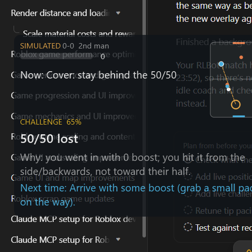

# Rocket Coach AI

A live coaching overlay for offline Rocket League 2v2 against RLBot / Psyonix bots, with post-match reports and
personalised Custom Training plans. Free, local-first, Windows.

> **Status (2026-10-25):** live integration verified on this PC: RLBot v5 launched the Epic build in offline
> bot mode, the coach connected, tracked the human car and drew the overlay over the game. Tip accuracy in real
> play and a full real-match report haven't been reviewed yet. See "Verification status".



## How it works

```
RLBot v5 server ──GamePacket 120 Hz + BallPrediction──▶ RLBot *Script* (read-only)
                                                       │
                     mock simulator / recording ──────▶│ GameFrame (rocketcoach/telemetry)
                                                       ▼
            context (roles, time-to-ball, threat) ─▶ events (touches, kickoffs, aerials, goals, gaps)
                                                       ▼
          tactical rules · boost coach · mechanics analyzer ─▶ Observations (impact, confidence, evidence)
                                                       ▼
          Coach prioritiser (1 tip at a time, cooldowns, dedupe, min confidence, categories, focus)
               │ live                                     │ end of match
               ▼                                          ▼
     PySide6 overlay + optional voice           SQLite + report (MD/HTML, heatmap) + training plan
                                                          │ optional
                                                          ▼
                                               Claude debrief (compact JSON only)
```

- **Telemetry** comes from an RLBot v5 *Script*: a process RLBot starts next to the match that only reads game
  state. It never sends inputs or state changes, injects nothing into Rocket League, and only works in offline
  matches RLBot launches.
- **Rules are deterministic Python**, with persistence windows, confidence scores and context, not single
  conditions. For example, "last-back over-commit" only fires when you're the deepest player, driving at the
  ball, the opponent gets there first, the ball isn't already being cleared, and your teammate can't cover.
  Arriving first as last man is counted as a *good* challenge instead.
- **The language model is optional and never live.** Reports are complete without it.

## Install

Requirements: Windows 10/11, Python 3.13 (`py -3.13`), about 350 MB of disk.

```bash
setup.bat
```

or manually:

```bash
py -3.13 -m venv .venv
```
```bash
.venv\Scripts\python.exe -m pip install -r requirements.txt -r requirements-optional.txt
```

Optionally copy `config.example.toml` to `config.toml` and edit it.

## Try it without the game (simulated)

```bash
demo.bat
```

This shows the overlay over your desktop, driven by a small 2v2 simulator whose "You" car has deliberate flaws
(ball-chasing, corner-boost greed, boosting at top speed). Everything it shows is labelled **SIMULATED**.
Headless version, prints the tips it would have shown and writes a report:

```bash
.venv\Scripts\python.exe -m rocketcoach analyze --seed 11
```

## Play with real coaching (needs one-time RLBot setup)

1. Install **RLBot v5** with `rlbot-v5-installer.msi` from <https://rlbot.org/v5/>. This puts `RLBotServer.exe`
   in `%LOCALAPPDATA%\RLBot5\bin`. The old v4 "RLBotGUIX" on this PC is not used.
2. In Rocket League set **Video > Display Mode = Borderless**. Desktop overlays cannot draw over exclusive
   fullscreen.
3. Close Rocket League, then run:
   ```bash
   play.bat
   ```
   This calls `rocketcoach launch-match` with `rlbot/match_2v2.toml`: you plus a Psyonix All-Star teammate
   against two All-Stars, on the Epic launcher, with the coach script attached. RLBot launches the game. Since
   Easy Anti-Cheat became mandatory online (2026-04-28), offline/modded play needs EAC **off**. If the game starts
   with EAC on, RLBot won't connect, so see Troubleshooting.
4. **Starting matches from the RLBot window instead:** run `coach.bat` once (before or after starting the
   match). It runs in that command prompt window: closing the window stops the coach and its overlay. The coach watches whatever match RLBot is running, so it doesn't need to be part of that match, and
   it keeps following when you start, restart or change matches. Running it again replaces the old coach (only
   one overlay at a time).
5. To face community bots, add `[[cars]]` entries with `config_file = "<path to bot.toml>"` from the RLBot launcher's
   bot pack. You can also start any match from the RLBot launcher and add `rlbot/rocketcoach.script.toml` as a script.

When the match ends, the HTML report opens in your browser.

### Hotkeys (global)

| Keys | Action |
|---|---|
| Ctrl+Alt+O | Toggle interact mode: overlay becomes draggable/resizable and the settings panel opens; press again to lock and go click-through |
| Ctrl+Alt+N | Mute/unmute voice |
| Ctrl+Alt+H | Hide/show overlay |
| Ctrl+Alt+Q | Quit (writes a report for the match so far) |

On this PC, Ctrl+Alt+M was already taken by another program, so mute uses Ctrl+Alt+N. If a hotkey conflicts, the
log says so; change it in `config.toml`.

### Other commands

```bash
.venv\Scripts\python.exe -m rocketcoach list
```
```bash
.venv\Scripts\python.exe -m rocketcoach report 3 --open
```
```bash
.venv\Scripts\python.exe -m rocketcoach export
```
```bash
.venv\Scripts\python.exe -m rocketcoach delete --match-id 3
```
```bash
.venv\Scripts\python.exe -m rocketcoach verify-packs
```
```bash
.venv\Scripts\python.exe -m rocketcoach bench
```
```bash
.venv\Scripts\python.exe -m rocketcoach run --source file --file data\recordings\<file>.jsonl.gz --speed 2
```

## What you see while playing

The coaching text sits in the **top-left corner** (drag it elsewhere in interact mode, Ctrl+Alt+O).

- **BALL / BOOST badge** next to your boost bar: whether to play the ball (or stay with the play) or grab
  boost now, with a few words why ("pad left", "your ball", "12 boost: don't 50 empty, pad ahead"). It follows the
  "Now:" line. When the ball is yours or a save is needed, it's BALL. When you're rotating under ~25 boost (35 for
  newer players, 20 at GC+), it's BOOST if an active pad is close to your path. When you're last back, only pads
  goal-side of the ball count, so it never sends you to a corner 100 out of position. One exception: a contested
  50/50 at under 15 boost with your teammate behind you is BOOST. The pad shows as an orange dot on the minimap.
- **Now:** one line with your job right now: kickoff, challenge, shadow, back post, support, cover, SAVE, or
  with the ball, **what to do with it** (shoot / pass / center / control / clear / push). Green = you're in the
  right spot, amber = move, red = emergency. Each instruction stays up at least 2 s unless something urgent happens.
- **Minimap** in its **own small window** (default bottom-left, drag it in interact mode): you, teammate (blue),
  opponents (orange), ball (white) and a ring where the coach wants you.
- **Short calls**: a headline, one short "why", one short "Next:". The full detail goes in the report.
- **Kickoffs**: your spawn ("left diagonal", "right off-center", "back center"), whether you go (closest car;
  left goes on equal diagonals) or what to do instead (cheat up / grab boost). Afterwards: "Kickoff lost left",
  who arrived first and by how much, and a fix. "You were the kicker" if you should have gone and didn't.
- **50/50 verdicts** after every contested touch, with the main reason and a fix.
- **Play reviews** during replays/countdowns: goals against, turnovers, and "Better there: center" when the
  learned model says another option works better from where you just played the ball.

### Learning from you and your opponents

Every touch by every car (you, your teammate, both opponents) is classified as shoot / pass / center /
control / clear / push, scored by what happened in the next 4 s (goal +1, shot +0.5, keeping the ball +0.15,
losing it -0.15, conceding a shot -0.6, conceding a goal -1), and stored per situation (zone, pressure, defender
back, teammate open). Live advice and "Better there" use those averages, starting from coaching defaults that real
data overrides as it accumulates (6+ samples before it contradicts you). Real and simulated data are kept apart.
To rebuild it from all your recordings:

```bash
.venv\Scripts\python.exe -m rocketcoach learn
```

### Rank estimate and coaching level

Each report includes an **estimated level** with a range, blending your real rank (`real_rank` in config or the
settings panel), your past matches, and this match's movement stats (average speed, time supersonic, boost per
minute) against **rough** per-rank benchmarks. Matches against bots read slower than ranked, so treat it as a
trend, not a verdict. Your rank also sets the **coaching level** (Bronze-Silver / Gold-Plat / Diamond-Champ /
GC-SSL): kickoff technique (flip vs speedflip), simpler wording for newer players, how close counts as "in
position", and training-pack difficulty.

## What the coach looks at

| Area | Live tips | Post-match | Source of truth |
|---|---|---|---|
| Last-back over-commit, net exposed, double commit, ball-side rotation, passive support, good shadow defense | yes | counts, timestamps, evidence | measured positions/velocities + time-to-ball *estimate* |
| Boost: time under 20/40/60, collected vs spent, supersonic waste, corner-100 trips (last back?), small-pad near-misses, starvation vs fine low-boost play, boost entering 50/50s, heatmap, timeline | yes (3 rules) | yes | measured boost; *supersonic waste tip uses your real boost input* |
| Aerials: attempts, contact, takeoff distance, double-jump takeoffs | after repeated misses | yes, graded at ≥5 attempts | measured air state + touches |
| Recoveries: time from landing to 1200 uu/s | after repeated slow ones | yes, graded at ≥5 | measured |
| Shots: on-target, power, corner placement, off-target attacking touches | no | yes | *estimate* (straight-line projection) |
| BALL / BOOST badge | always on | seconds on each call | rule-based from measured boost, pads and positions; *thresholds are coaching heuristics* |
| Positioning guide ("Now:" + minimap target) | always on | % of time at the recommended spot | rule-based targets from measured positions; *the target spots are coaching heuristics* |
| 50/50s: every contested touch, result + reasons | every challenge | won/lost, play reviews | measured contact; *result is an estimate* (where the ball goes in the next second) |
| Goal-against / turnover reviews | during replays | "Play reviews" section | measured positions vs the guide's targets |
| Kickoffs | kickoff tip | yes | *estimate* (where the ball goes after) |
| Dribbles/flicks, wall & backboard touches | no | counts only | measured |
| Air roll skill, wavedash/half-flip quality, wall-read quality, flip resets | no | listed as **not measured** | would need validated input/video analysis |

Grades are shown only with enough data (positioning/boost: ≥120 s of play; mechanics: minimum sample counts). Each
grade states its exact criteria.

### Data available from RLBot v5 (checked against `rlbot_flatbuffers` 0.19.0)

Available: positions, velocities, rotation, angular velocity, boost, `air_state`, has_jumped/double_jumped/dodged,
dodge direction, demolished timer, supersonic, latest ball touch, **the player's last controller input**, accolades,
score stats, boost pad states, 6 s ball prediction, field/goal info. **Not available: per-wheel contact** (only
"on ground"). Unavailable fields are listed as capabilities in each report.

## Training packs

24 Custom Training packs across 11 skills, from the prejump.com database. On 2026-10-25,
`rocketcoach verify-packs` fetched every pack's page and confirmed **24/24** codes and names. Results are stored
in `data/pack_verification.json`, and the report marks any pack as UNVERIFIED if that check hasn't passed. Plans
hold a warm-up plus at most **two** focus skills chosen from observed weaknesses, each with a success target, when
to step up, the next pack, and an in-game search fallback. Skills that packs can't train (rotation, boost routes,
50/50s) get Free Play / in-match drills instead. With too little evidence, the plan says so instead of recommending
something.

## Optional Claude debrief

Off by default. To enable it, set `[llm] provider = "anthropic"` and either `ANTHROPIC_API_KEY` or an
`ant auth login` profile. After each match, one request goes out with a compact JSON summary: metrics, top
mistakes, grades and the plan. It contains no video, no raw telemetry and no names. Guards: 10 requests/hour,
$2/month budget, 20 s timeout, 2 SDK retries, 600 output tokens, effort "low", and a response cache. The request
opts into Anthropic's server-side refusal fallback. Every call's tokens and cost are logged in SQLite.

**Estimated cost** (~2,500 input + ~400 output tokens per report): `claude-opus-5-5` (default) ≈ **$0.018/match**;
`claude-haiku-5-5` ≈ **$0.0005/match**. 30 matches/month ≈ $0.55 or $0.02.

A local LLM is **not** enabled. With 7.8 GB RAM and a 4 GB GTX 1650 that Rocket League already uses, a 7B model would
swap or starve the game. The `Provider` interface (`rocketcoach/coach/llm.py`) leaves room to add one, for example
for post-match-only use when the game is closed. No local model was benchmarked.

## Privacy & data

Everything is stored locally in `data/`: `rocketcoach.db` (SQLite), `recordings/` (gzip telemetry, 15 Hz, about
0.5 MB per match, can be turned off with `record_telemetry = false`), `reports/` and `logs/`. Use `export` and
`delete` (`--all` wipes everything, recordings included). The app reads no credentials and touches no other
processes; the overlay only registers its own global hotkeys.

## Verification status

| Item | Status |
|---|---|
| 55 unit/integration tests (rules incl. false-positive cases, events, gaps/duplicates/restarts, boost, coach suppression, recommender, reports, history comparison, recorder truncation, config validation, LLM success/failure/budget/cache, real flatbuffer packet conversion, overlay click-through style + painting) | **pass** (`.venv\Scripts\python.exe -m pytest`) |
| Overlay over the desktop with simulated telemetry, real Win32 click-through, global hotkeys | **verified on this PC** (screenshot above) |
| CPU / memory | analysis alone: 0.07 ms/frame, about 0.4% of one core at 120 Hz; whole overlay process incl. simulator: **6.3% of one core, 68 MB RAM** (i5-10500H) |
| Training-pack codes | **24/24 verified** against source pages on 2026-10-25 |
| RLBot v5 match launch on the Epic + EAC build (`play.bat`) | **verified**: RLBot started `RocketLeague.exe -rlbot` (non-EAC) |
| Live telemetry (60 packets/s, real field info, human car identified) | **verified** in a 2v2 vs Psyonix All-Stars |
| Overlay over the real game | **verified** (status, score, boost and role update live) |
| Guide, 50/50 verdicts and play reviews replayed on 3.4 min of real recorded play | 15 live calls (2 goal reviews, 3 challenge verdicts, 1 turnover review); "Now:" line changes ~every 1.5 s |
| New overlay (Now line, minimap, Next time) live over the real game | **not yet seen live**; checked on simulated data |
| Tip accuracy in real play | **needs your judgement**: aerial contact (0/6 in the recording) looks undercounted |
| Voice (SAPI5) | dependency installed; not exercised in tests |
| Claude API with a real key | not run (logic tested with a fake client) |

Rule thresholds were tuned on simulated play. Expect to adjust `min_confidence` and possibly rule thresholds after
the first real matches. The mock simulator is a kinematic stand-in, so scores and stat levels in simulated reports
(e.g. `docs/sample-report-SIMULATED.md`) are not realistic.

## Troubleshooting

- **Overlay shows "No telemetry: waiting for an RLBot match"**: RLBot isn't running a match. A match you start
  from Rocket League's own menus (Play > Offline) is **not** an RLBot match and sends no data: start it with
  `play.bat` (or the RLBot launcher) and let RLBot load it. Check `data/logs/rocketcoach.log`.
- **Coach shows "Connected to RLBot: waiting for a match to start"** while you're in a match: make sure the match
  was started through RLBot (play.bat or the RLBot window), not Rocket League's own menus. Matches started
  from the RLBot window are picked up automatically; it can take 1-2 s after kickoff.
- **Coach is following a bot / not finding you**: RLBot sometimes runs a match without listing its players. The
  coach then identifies you by name: set `player_name` under `[coach]` in `config.toml` to your in-game name. It
  also remembers names it has seen as human before (`data/known_humans.json`).
- **Ping shown in game**: normal. RLBot matches run as a local server on your PC; they are still offline.
- **Game launches but RLBot never connects**: make sure Rocket League started with Easy Anti-Cheat **off**. RLBot
  needs the non-EAC offline path. Close the game and let RLBot launch it.
- **Overlay not visible in game**: switch to Borderless. Exclusive fullscreen hides every desktop overlay.
- **Overlay covers something**: Ctrl+Alt+O, drag it, Ctrl+Alt+O again. The position is saved.
- **A hotkey does nothing**: another app owns it (see the log). Change it in `config.toml`.
- **Too many / too few tips**: raise/lower `min_confidence` or `min_seconds_between_tips`, or disable categories.

## Next priorities

1. Run the first real RLBot match and compare live tips against the recorded telemetry. Re-tune thresholds.
2. Validate the time-to-ball estimate against real car physics, perhaps by using ball-prediction slices for intercepts.
3. Use the real `last_input` to measure fast-aerial timing, half-flips and wavedashes properly.
4. Add `.replay` parsing (e.g. subtr-actor) to analyse matches played without the coach running.
5. Add a small settings/history window with trend charts across matches.

## Project layout

```
rocketcoach/
  telemetry/  models, RLBot v5 adapter, mock simulator, recorder, file replay
  analysis/   context, events, tactical rules, boost coach, mechanics
  coach/      prioritiser, voice, optional LLM provider
  overlay/    PySide6 overlay window + settings panel
  report/     post-match report (Markdown + HTML)
  training/   pack catalog (packs.json) + recommender/verifier
  storage/    SQLite
  engine.py   per-match session wiring;  app.py  CLI
rlbot/        match_2v2.toml, rocketcoach.script.toml
tests/        pytest suite
docs/         PLAN.md, simulated sample report + screenshot
```
